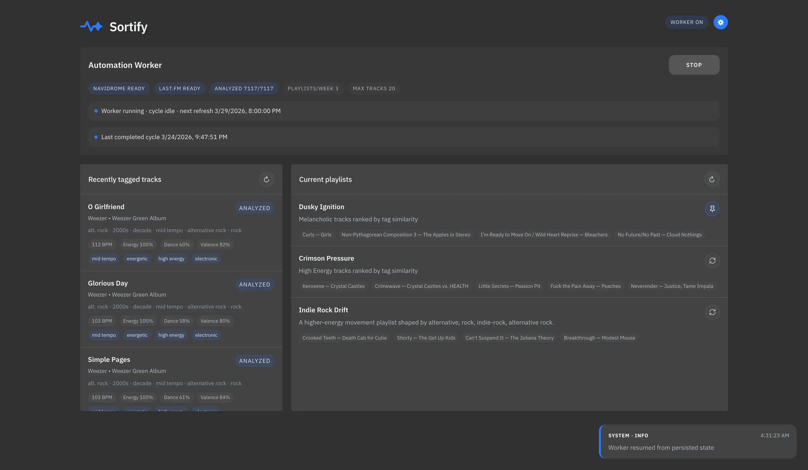

<p align="center">
  
</p>

# Sortify

It's a self-hosted playlist assistant for Navidrome. It scans your library, stores metadata locally, and generates recommended playlists from the web UI. It does NOT touch your files metadata and instead stores it in a local SQLite database, keeping your files safe and untouched.

## Screenshot



## Requirements

- Navidrome
- Last.FM API key

## Docker build

```
services:
  sortify:
    image: "ghcr.io/lklynet/sortify:latest"
    container_name: sortify
    ports:
      - "3001:3001"
    restart: unless-stopped
    volumes:
      - ./data:/data
```

Change `./data` if you want data to persist through container restarts.

## Configuration

All settings can be updated via the app UI. It supports these environment variables:

- `PORT`
- `SUBSONIC_URL`
- `SUBSONIC_USER`
- `SUBSONIC_PASSWORD`
- `LASTFM_API_KEY`
- `MAX_TRACKS_PER_PLAYLIST`
- `SORTIFY_DB_PATH` (path to the SQLite database; defaults to `data/sortify.db`)
- `SORTIFY_PYTHON` (Python interpreter used for local audio analysis; defaults to `python3`)
- `AUDIO_ANALYSIS_ENABLED` (set to `false` to disable local audio analysis)

## Playlist modes

In the **Current playlists** panel, the mode button is icon-only. Clicking it cycles through:

- **↻ Weekly (dynamic):** replaced by Sortify on refresh cycles.
- **📌 Pinned:** keeps the playlist in place, but refreshes its tracks.
- **🔒 Locked:** keeps the playlist exactly as-is, with no automatic changes.

## Features

- **Radio playlists** — pick 1–12 seed tracks and Sortify infers a taste profile from them (shared tags, BPM, energy, release year), then fills out a **Pinned** playlist with library tracks that match. A quick way to build a "station" around a few songs you love.
- **Weekly email digest** — optionally configure SMTP in the UI; on each weekly refresh Sortify emails you a summary of the playlists it generated.
- **Fewest-listens priority** — per-playlist toggle that re-ranks a playlist's tracks to surface the ones you've listened to least, so you hear more of your library instead of the same favorites.
- **Local audio analysis** — BPM, energy, and other audio features are computed locally from your files (no external audio API), which powers mood- and BPM-aware playlist generation.

## License

AGPL-3.0-or-later
